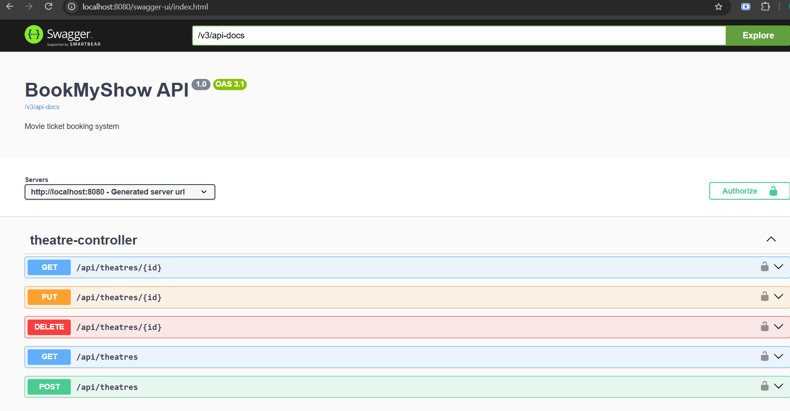

# BookMyShow — Movie Ticket Booking System

A backend movie ticket booking system built with Spring Boot, demonstrating production-style patterns: JWT authentication, role-based access control, concurrency-safe seat booking, automated testing, containerization, and CI.

## Features

- **Auth**: JWT-based registration/login with role-based access (`USER`, `ADMIN`)
- **Movie / Theatre / Screen / Show management**: full CRUD for admins, public browsing for everyone
- **Seat booking with concurrency control**: pessimistic row-level locking (`PESSIMISTIC_WRITE`) ensures two users can never double-book the same seat, even under simultaneous requests
- **Booking lifecycle**: hold seats → pay → confirm, with a scheduled job that auto-releases abandoned holds after 5 minutes
- **Global exception handling**: consistent JSON error responses with correct HTTP status codes
- **API documentation**: interactive Swagger UI
- **Automated tests**: unit tests (Mockito) + a Testcontainers integration test that fires 10 concurrent threads at the same seat to prove exactly one booking succeeds
- **Containerized**: multi-stage Dockerfile + docker-compose (app + MySQL)
- **CI**: GitHub Actions runs the full build and test suite on every push

## Deployment

Deployed on AWS:
- **EC2** (Amazon Linux 2023) runs the app as a Docker container
- **RDS MySQL** holds the data, reachable only from the EC2 security group
- **Flyway** applies the schema migrations on startup
- Secrets (DB password, JWT secret) are passed as environment variables, not committed to the repo

Live demo (when the server is running): `http://NEW_IP:8080/swagger-ui/index.html`



## Tech Stack

Java 17 · Spring Boot · Spring Security (JWT) · Spring Data JPA · Hibernate · MySQL · Flyway · MapStruct · Lombok · JUnit 5 · Mockito · Testcontainers · Docker · GitHub Actions · Maven

## Architecture
Controller → Service → Repository → Database
- DTOs (Java records) separate API contracts from JPA entities
- MapStruct handles entity ↔ DTO mapping
- `@ControllerAdvice`-based global exception handler returns clean, typed error responses
- JWT filter validates tokens per-request; Spring Security enforces role-based route access

## Concurrency Design

When two users try to book the same seat at the same moment:

1. `holdSeats()` acquires a **pessimistic write lock** on the relevant `ShowSeat` rows via a custom repository query
2. The second transaction physically waits at the database level until the first commits or rolls back
3. If the seat is already `LOCKED` or `BOOKED`, the second request is rejected with a `409 Conflict`
4. A unique constraint on `(show_id, seat_id)` acts as a second safety net
5. A scheduled job (`@Scheduled`, every 60s) releases seats from bookings that were never paid for within 5 minutes

This is proven by `BookingConcurrencyIT` — an integration test using Testcontainers that spins up a real MySQL instance and fires 10 threads at the same seat, asserting exactly one booking succeeds.

## Running Locally

### Prerequisites
- Java 17
- Maven (or use the included `mvnw`)
- MySQL running locally, or Docker

### Option 1 — Local MySQL
1. Create a database: `CREATE DATABASE bookmyshow;`
2. Set your DB credentials in `src/main/resources/application-dev.yml`
3. Run: `./mvnw spring-boot:run`

### Option 2 — Docker Compose (recommended)
```bash
docker compose up --build
```
This starts both the app and a MySQL container, runs Flyway migrations automatically, and exposes the app on `http://localhost:8080`.

### API Documentation
Once running, open: http://localhost:8080/swagger-ui/index.html


## Running Tests

```bash
./mvnw test              # unit tests
./mvnw verify             # unit + integration tests (requires Docker for Testcontainers)
```

## Project Structure

src/main/java/in/strikes/bookmyshow/
├── config/ # Security, JWT, OpenAPI, scheduling config
├── controller/ # REST endpoints
├── service/ # Business logic interfaces + implementations
├── repository/ # Spring Data JPA repositories
├── entity/ # JPA entities
├── dto/ # Request/response records
├── mapper/ # MapStruct entity ↔ DTO mappers
├── exception/ # Custom exceptions + global handler
├── security/ # JWT filter, user details service
└── scheduler/ # Booking expiry job

src/main/resources/
├── application.yml
├── application-dev.yml # local overrides (gitignored)
├── application-docker.yml
└── db/migration/ # Flyway SQL migrations


## What I'd Build Next

- Deploy to AWS (RDS + ECS/EC2) with CD via GitHub Actions
- Payment gateway integration (currently mocked)
- Redis caching for seat availability lookups
- Rate limiting on booking endpoints

## License

This project is for portfolio/demonstration purposes.